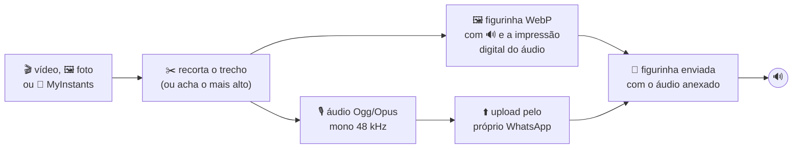

<div align="center">

# 🤖 kuebot

### O bot de figurinhas que mora no seu WhatsApp

**Foto, vídeo, GIF, texto e até figurinha com som 🔊**: manda a mídia, digita um comando e a figurinha chega em segundos.


[**Começo rápido**](#começo-rápido) · [**Comandos**](#comandos) · [**Figurinha com som**](#-figsom--figurinha-com-som) · [**Hospedar de graça**](#hospedagem-gratuita-24h) · [**Problemas**](#problemas-comuns)

</div>

---

## Como é na prática

```text
👤 você      [foto do gato] !fig redondo bom dia grupo
🤖 kuebot    ⏳ … ✅  → 🐱 figurinha redonda com "bom dia grupo"

👤 você      ↩️ respondendo a um vídeo: !figsom 3-8
🤖 kuebot    ⏳ … ✅  → 🔊 figurinha animada que fala

👤 você      !animado tremer SOCORRO
🤖 kuebot    ⏳ … ✅  → 🌀 texto tremendo, em figurinha

👤 amigo     !fig
🤖 kuebot    (silêncio: o bot está desligado neste chat 🤫)
```

Ele roda no **seu próprio número** e começa **desligado**. Só você liga, num chat específico ou em todos, e dá até para pôr um tempo para ele desligar sozinho.

---

## Funcionalidades

<table>
<tr>
<td width="33%" valign="top">

### 🖼️ Foto → figurinha
4 modos: **esticar**, **cortar**, **ajustar** (bordas transparentes) e **redondo**. Já respeita a orientação da foto do celular.

</td>
<td width="33%" valign="top">

### 🎬 Vídeo/GIF → animada
Escolha o trecho (`3-8`) e o bot comprime sozinho para caber no limite do WhatsApp, sem você se preocupar com nada.

</td>
<td width="33%" valign="top">

### 🔊 Figurinha com som
A novidade do WhatsApp: o som do vídeo, de um áudio ou de um link do **MyInstants**, tocando ao clicar na figurinha.

</td>
</tr>
<tr>
<td valign="top">

### 💬 Legenda de meme
Texto branco com contorno, no estilo meme, em qualquer figurinha (parada ou animada) e em **11 cores**.

</td>
<td valign="top">

### 🌈 Texto animado
**7 efeitos**: arco-íris, pulsar, tremer, piscar, digitar, balançar e neon.

</td>
<td valign="top">

### 🎞️ Vira GIF
Figurinha animada ou vídeo vira **GIF do WhatsApp** ou arquivo `.gif`.

</td>
</tr>
<tr>
<td valign="top">

### ↩️ Responde a mídias antigas
Não precisa reenviar: **responda** à foto, ao vídeo ou ao áudio com o comando.

</td>
<td valign="top">

### 🔐 Só você manda
Começa desligado, liga por chat ou geral, **com timer**. Comandos de estranhos são ignorados em silêncio.

</td>
<td valign="top">

### ☁️ Liga 24h de graça
Guia e script prontos para hospedar numa máquina **gratuita do Google Cloud**.

</td>
</tr>
</table>

---

## Começo rápido

> **Precisa de:** [Node.js 20+](https://nodejs.org/) (confira com `node -v`), [Git](https://git-scm.com/) e o WhatsApp no celular. O **FFmpeg já vem junto**, não precisa instalar.

```bash
git clone https://github.com/kauebbs/StickerWPPmaker.git
cd StickerWPPmaker
npm install
npm start
```

1. **Escaneie o QR Code** que aparece no terminal (celular → *Aparelhos conectados* → *Conectar um aparelho*).
2. **Ligue o bot** no chat onde quer usar: mande `!ligar` do seu número.
3. **Teste**: mande uma foto com a legenda `!fig`. 🎉

A sessão fica salva: nas próximas vezes é só `npm start`. Para parar, `Ctrl + C`.

> 💡 **Recomendado:** ter o [Google Chrome](https://www.google.com/chrome/) instalado. Com ele o `!gif` manda GIF de verdade; sem ele, manda o arquivo `.gif`.

---

## Comandos

Mande **`!menu`** no WhatsApp para ver tudo a qualquer momento.

### Colinha

| Comando | O que faz | Exemplo |
|---|---|---|
| `!fig` | Foto, vídeo ou GIF → figurinha | `!fig redondo 2-6 bom dia` |
| `!figsom` | Figurinha **com som** 🔊 | `!figsom 3-8` |
| `!texto` | Figurinha só de texto | `!texto azul sextou` |
| `!animado` | Texto animado | `!animado neon boa noite` |
| `!gif` | Vídeo/figurinha animada → GIF | `!gif 0-5` |
| `!img` | Figurinha → imagem PNG | `!img` |
| `!renomear` | Troca pacote e autor | `!renomear Pack \| Eu` |
| `!menu` | Lista de comandos | `!menu` |

**Atalhos:** `!s` / `!sticker` = `!fig` · `!fs` = `!figsom` · `!attp` = `!animado` · `!ttp` = `!texto`

### 🖼️ `!fig` — foto, vídeo ou GIF → figurinha

Mande a mídia com o comando na legenda **ou responda** a uma mídia que já está no chat. As opções vão **no começo**, em qualquer ordem; o que sobrar vira **legenda**.

| Opção | Valores |
|---|---|
| **Modo** | `esticar` (padrão) · `cortar` · `ajustar` (mantém a proporção, bordas transparentes) · `redondo` |
| **Trecho do vídeo** | `3-8` (do 3s ao 8s) · `1:05-1:12` · `4s` (só os 4 primeiros segundos) |
| **Cor da legenda** | `branco` `preto` `vermelho` `azul` `verde` `amarelo` `rosa` `roxo` `laranja` `ciano` `dourado` |

```text
!fig
!fig cortar
!fig redondo 2-6 bom dia grupo
!fig amarelo quando o código compila de primeira
```

Figurinhas animadas duram até **10 s**; sem trecho, o bot usa os **6 primeiros**.

### 🔊 `!figsom` — figurinha com som

A figurinha chega com o ícone 🔊 e **toca o som quando alguém clica nela**.

**De onde vem o som:**
- ↩️ **Responda a um vídeo** com `!figsom` → usa o som do próprio vídeo.
- 🖼️ **Mande uma foto ou vídeo** com a legenda `!figsom` **respondendo a um áudio** (mensagem de voz, MP3...).
- 🔗 **Cole um link do [MyInstants](https://www.myinstants.com/)** junto com a foto ou o vídeo.

**Regras do WhatsApp:** figurinha **animada** com até **5 s** de som; **parada** com até **10 s**. Com som separado e sem trecho escolhido, o bot pega sozinho **o pedaço mais alto**, pulando o silêncio do começo.

| Opção | O que faz |
|---|---|
| modo · trecho · cor · legenda | As mesmas do `!fig` (o trecho escolhe o pedaço do **som**) |
| `parada` | O vídeo vira figurinha **parada** e aceita até **10 s** de som |
| `separado` | Figurinha e som em **mensagens separadas** (o som como mensagem de voz) |
| `longo` 🧪 | **Experimental:** até **10 s** na animada e **20 s** na parada. Pode não tocar em alguns aparelhos |

```text
!figsom
!figsom 3-8
!figsom parada 0-10
!figsom redondo BOOM
!figsom longo
!figsom https://www.myinstants.com/pt/instant/vine-boom-sound-70972/
```

<details>
<summary><b>🧪 Como funciona por dentro (e por que é experimental)</b></summary>

<br>

O WhatsApp [liberou figurinhas com som no Brasil em 24/11/2026](https://www.archyde.com/whatsapp-begins-rolling-out-audio-stickers-to-users-in-brazil/), mas **não existe API oficial** para elas. O bot usa os módulos internos do próprio WhatsApp Web, do mesmo jeito que a extensão [WhatsApp Audio Stickers](https://github.com/KaraBala10/whatsapp-audio-stickers):



- A opção de figurinha com som é ligada **só na página do bot**, sem mudar nada na sua conta.
- Quem recebe precisa de um WhatsApp que já mostre figurinha com som; nos outros, ela chega como figurinha comum.
- No WhatsApp Web, animação e som podem sair fora de sincronia; no celular fica certo.
- Se o WhatsApp Web recusar (ou mudar por dentro), o bot avisa e manda a figurinha e o som separados.
- A versão antiga do WhatsApp Web usada para o QR Code aparecer não tem figurinha com som. Com a sessão salva, o bot abre a versão mais nova sozinho; se aparecer o aviso de "versão sem figurinha com som", é só reiniciar.

</details>

### 🔤 `!texto` e 🌈 `!animado`

```text
!texto sextou!
!texto azul bom dia
!animado sextou galera              → arco-íris (padrão)
!animado tremer SOCORRO
!animado digitar carregando...
!animado neon rosa boa noite
```

Efeitos do `!animado`: `arcoiris` · `pulsar` · `tremer` · `piscar` · `digitar` · `balancar` · `neon`

### 🎞️ `!gif` · 🖼️ `!img` · 🏷️ `!renomear`

Sempre **respondendo** à mídia:

```text
!gif                       → vídeo ou figurinha animada vira GIF
!gif 0-5                   → só os 5 primeiros segundos
!gif arquivo               → recebe o arquivo .gif
!img                       → figurinha vira imagem PNG
!renomear Meu Pack | Eu    → reenvia com outro pacote e autor
```

---

## Ligar e desligar o bot

O kuebot foi feito para rodar no seu **número pessoal** sem que qualquer pessoa consiga usá-lo. Estes comandos **só funcionam vindos do seu número**:

| Comando | O que faz |
|---|---|
| `!ligar` | Liga **neste chat**: todo mundo do chat ou grupo pode usar |
| `!ligar 2h` | Liga por um tempo e desliga sozinho (`30m`, `1h30`, `1d`...) |
| `!ligar tudo` | Liga em **todos os chats** (também aceita tempo: `!ligar tudo 1h`) |
| `!desligar` · `!desligar tudo` | Desliga neste chat · em todos |
| `!status` | Mostra onde está ligado e por quanto tempo |

- Nos chats desligados, comandos de outras pessoas são **ignorados em silêncio**.
- **Seus** comandos funcionam em qualquer chat, mesmo com o bot desligado (`OWNER_ALWAYS_ALLOWED=false` muda isso).
- O que está ligado fica salvo em `bot-estado.json` e continua igual depois de reiniciar.

---

## Hospedagem gratuita 24h

Quer o bot ligado sem deixar o PC ligado? O guia **[HOSPEDAGEM.md](HOSPEDAGEM.md)** ensina a rodar de graça numa máquina **e2-micro do Google Cloud**. É um comando para instalar tudo e o `pm2` mantém o bot no ar, voltando sozinho se cair.

```bash
curl -fsSL https://raw.githubusercontent.com/kauebbs/StickerWPPmaker/main/deploy/setup-servidor.sh | bash
```

---

## Configuração

Tudo fica em [`src/config.js`](src/config.js) e pode ser trocado por variáveis de ambiente, sem mexer no código:

```bash
# CMD
set STICKER_AUTHOR=MeuNome&& set STICKER_NAME=MeuPack&& npm start
```
```powershell
# PowerShell
$env:STICKER_AUTHOR="MeuNome"; $env:STICKER_NAME="MeuPack"; npm start
```

<details>
<summary><b>📋 Todas as variáveis</b></summary>

<br>

| Variável | Padrão | Descrição |
|---|---|---|
| `STICKER_NAME` / `STICKER_AUTHOR` | `.` / `kuebot` | Nome do pacote e autor das figurinhas |
| `BOT_PREFIX` | `!` | Prefixo dos comandos |
| `OWNER_ALWAYS_ALLOWED` | `true` | Seus comandos funcionam mesmo com o bot desligado |
| `ANIM_DEFAULT_DURATION` | `6` | Duração da animada quando nenhum trecho é informado (s) |
| `ANIM_MAX_DURATION` | `10` | Duração máxima da figurinha animada (s) |
| `ANIM_MAX_KB` | `900` | Tamanho máximo da figurinha animada (KB) |
| `STATIC_MAX_KB` | `100` | Tamanho máximo da figurinha parada (KB) |
| `SOUND_VIDEO_DURATION` | `5` | Segundos de som usados do vídeo no `!figsom` |
| `SOUND_ANIMATED_MAX_DURATION` | `5` | Som máximo na figurinha animada com som (s) |
| `SOUND_MAX_DURATION` | `10` | Som máximo na figurinha parada com som (s) |
| `SOUND_LONG_ANIMATED_MAX_DURATION` | `10` | Som máximo da animada no modo `longo` (s) |
| `SOUND_LONG_MAX_DURATION` | `20` | Som máximo da parada no modo `longo` (s) |
| `GIF_MAX_DURATION` | `15` | Duração máxima do `!gif` (s) |
| `GIF_WIDTH` | `480` | Largura dos GIFs gerados (px) |
| `MAX_CONCURRENT` | `2` | Quantas mídias processar ao mesmo tempo |
| `LOW_MEMORY` | `false` | `true` deixa o navegador mais econômico (servidores com 1 GB) |
| `WA_WEB_VERSION` | versões fixadas | Versão do WhatsApp Web (várias separadas por vírgula) ou `latest` |
| `LOAD_TIMEOUT_MS` | `60000` | Quanto esperar o WhatsApp Web carregar antes de tentar de novo (ms) |
| `HEADLESS` | `true` | `false` mostra a janela do navegador (para investigar problemas) |
| `BOT_DATA_DIR` | `%LOCALAPPDATA%\kuebot` | Onde ficam a sessão do WhatsApp e o cache |
| `BOT_STATE_FILE` | `bot-estado.json` | Onde fica salvo em quais chats o bot está ligado |
| `CHROME_PATH` | automático | Caminho do Chrome/Edge (`none` força o navegador padrão) |
| `FFMPEG_PATH` | automático | Caminho de outro FFmpeg, se quiser |

</details>

---

## Problemas comuns

<details>
<summary><b>😶 O QR Code não aparece no terminal</b></summary>

<br>

Em 23/11/2026 o WhatsApp Web mudou e o `whatsapp-web.js` parou de gerar o QR Code ([issue #201988](https://github.com/wwebjs/whatsapp-web.js/issues/201988)). O bot contorna isso carregando uma versão do WhatsApp Web anterior à mudança e, se não der certo, tenta as próximas.

Enquanto carrega, o terminal mostra o progresso a cada 10 segundos e salva uma captura da tela do navegador em `diagnostico.png`. Quando a biblioteca for corrigida:
```bash
npm update whatsapp-web.js
set WA_WEB_VERSION=latest&& npm start
```
</details>

<details>
<summary><b>⏳ <code>TimeoutError: Waiting failed</code> ou fica parado carregando</b></summary>

<br>

O bot já tenta de novo sozinho, trocando de versão e de navegador. Se continuar, veja a janela do navegador:
```bash
set HEADLESS=false&& npm start
```
A sessão fica em `%LOCALAPPDATA%\kuebot`, **fora do projeto** de propósito: se o projeto estiver no OneDrive, a sincronização deixa o navegador muito lento.
</details>

<details>
<summary><b>🔇 A figurinha com som aparece com "Couldn't play sticker sound"</b></summary>

<br>

- Se usou `longo`, tente sem: o WhatsApp foi feito para até 5 s (animada) e 10 s (parada).
- Confira se o vídeo tem som de verdade; GIFs do WhatsApp nunca têm.
- Use `separado` para mandar figurinha e som em mensagens separadas, que funciona em qualquer WhatsApp.
</details>

<details>
<summary><b>📱 Quero conectar outro número</b></summary>

<br>

Pare o bot, apague a pasta `%LOCALAPPDATA%\kuebot\sessao` e rode `npm start` de novo.
</details>

<details>
<summary><b>🎞️ O <code>!gif</code> manda um arquivo em vez de um GIF</b></summary>

<br>

O navegador que vem com o bot não envia vídeos. Instale o [Google Chrome](https://www.google.com/chrome/) e reinicie: o bot encontra sozinho.
</details>

<details>
<summary><b>🥔 A figurinha animada ficou com qualidade baixa</b></summary>

<br>

O WhatsApp limita o tamanho das figurinhas, então o bot reduz qualidade e quadros por segundo até caber. Um trecho mais curto (`!fig 2-5`) fica mais bonito.
</details>

<details>
<summary><b>💥 <code>npm install</code> deu erro</b></summary>

<br>

Confira se o Node é 20 ou mais novo (`node -v`). Se não for: `winget install OpenJS.NodeJS.LTS`, feche e abra o terminal e rode `npm install` de novo.
</details>

---

## Por dentro

```text
index.js              🧠 conexão com o WhatsApp, comandos e fila
src/
├── config.js         ⚙️  configurações (todas por variável de ambiente)
├── converter.js      🎨 imagem, vídeo, texto e áudio (sharp + FFmpeg)
├── soundsticker.js   🔊 envio da figurinha com som pelo WhatsApp Web
├── myinstants.js     🔗 download seguro de sons (só myinstants.com, HTTPS)
├── parse.js          🔤 leitura dos comandos e opções
└── access.js         🔐 onde o bot está ligado (só o dono)
deploy/setup-servidor.sh  ☁️  instala tudo num servidor Linux
ecosystem.config.js       ♻️  pm2 para manter o bot no ar
```

**Feito com** [whatsapp-web.js](https://github.com/wwebjs/whatsapp-web.js) (WhatsApp Web num navegador escondido) · [sharp](https://sharp.pixelplumbing.com/) (figurinhas, legendas e WebP animado) · [FFmpeg](https://ffmpeg.org/) (vídeo, áudio e GIF).

**Créditos da figurinha com som:** o envio segue a extensão [WhatsApp Audio Stickers](https://github.com/KaraBala10/whatsapp-audio-stickers) (MIT); as regras de duração vêm do [ZapSticks do Caos](https://github.com/ivandneto/zapsticks-do-caos) (MIT); a escolha do trecho mais alto e o MyInstants foram inspirados no [StikSound](https://github.com/SilverFeit/StikSound) (MIT OR Apache-2.0).

🔒 **Privacidade:** a sessão do WhatsApp, o `bot-estado.json` e o `diagnostico.png` ficam só no seu computador e estão fora do Git.

---

## Aviso

Este projeto **não é oficial** e não tem relação com o WhatsApp ou a Meta. Automatizar uma conta pessoal vai contra os termos de uso do WhatsApp e pode, em casos raros, levar ao **bloqueio do número**. Use com moderação e por sua conta e risco.

---

<div align="center">

Feito com ☕ e muitas figurinhas por **[Kauê Boscariol](https://github.com/kauebbs)**

<sub>Se o kuebot te salvou de mandar "kkkkk" pela milésima vez, deixa uma ⭐</sub>

</div>
